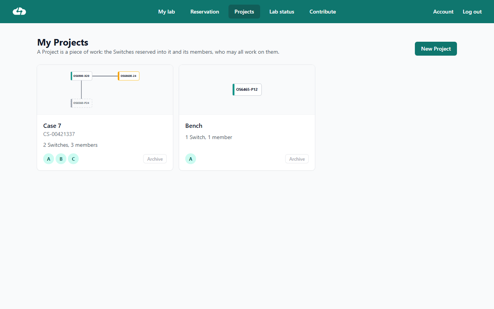
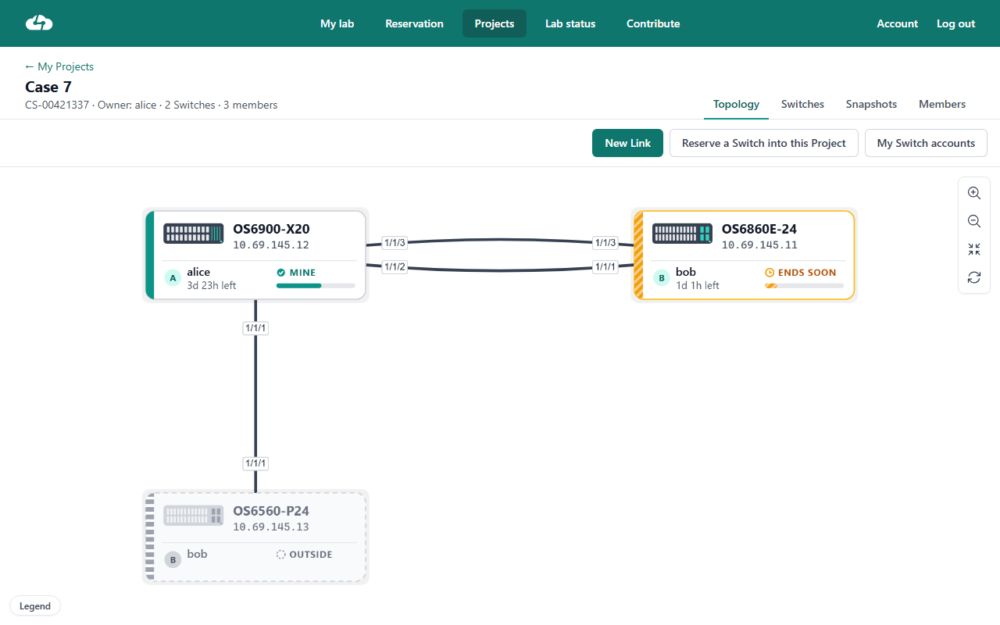
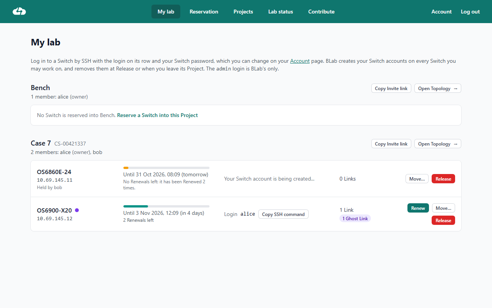
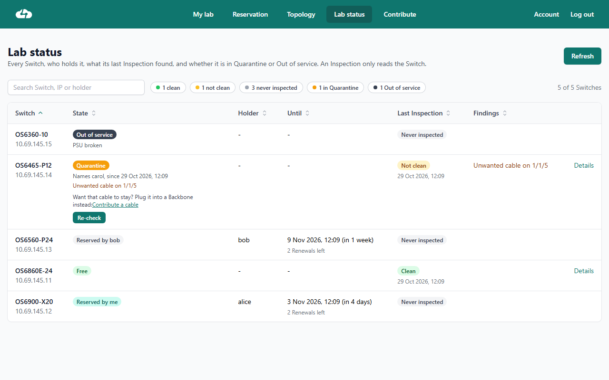

# BLab — Physical network lab, reservations & topologies

BLab lets teams reserve real lab switches, connect them through the lab backbone and manage their work together in a shared project. A web interface handles reservations, topology editing and lab health; the API and workers apply and reconcile changes on the equipment.

## Features

- **Reserve real hardware:** find available switches, reserve them for up to two weeks, renew twice, then release them when the work is done. Reservations can be grouped into a project.
- **Work together in projects:** invite members to a project, share its switches and topology, and manage its members and saved configurations.
- **Build topologies visually:** connect switch ports and lab tools with links carried across the backbone. The project canvas shows link and switch states, and its layout is shared with project members.
- **Recover project state:** save and restore snapshots of switch configurations, software releases, links and topology layout. BLab also takes a snapshot before a switch is released.
- **Keep the lab healthy:** inspect switches, review findings and quarantine, re-check after repairs, and contribute a switch or backbone cable through guided checks.
- **Manage switch access:** BLab provisions per-user switch accounts for project members and removes them when access ends.
- **Automate operations:** use the Django REST API and background workers alongside the Vue web app; Docker Compose runs the stack.

## Interface

These current interface captures use demo data.

<table>
  <tr>
    <td><p align="center"><strong>Projects</strong></p></td>
    <td><p align="center"><strong>Shared topology</strong></p></td>
  </tr>
  <tr>
    <td><p align="center"><strong>My lab</strong></p></td>
    <td><p align="center"><strong>Lab status</strong></p></td>
  </tr>
</table>

## Architecture (short)
- Backend: Django REST API, Paramiko (SSH) + optional vendor APIs to apply CLI changes.
- Database: Postgres (stores switches, ports, reservations, topology/shares).
- Frontend: web GUI for reservations, projects, topology editing, lab status and guided equipment contributions.
- Control plane: API requests and background workers carry out switch and backbone operations; management commands remain available for bulk onboarding and administration.

## How it works (high level)
1. Contribute equipment from the **Contribute** page. To add a switch with an EMP, the user selects its model; BLab reserves an available management address and provides the console commands needed to configure it. After the user connects its EMP to the management network and selects **Done**, BLab verifies access and its background worker onboards and inspects it. The switch enters service only after it passes inspection. Users can also contribute a cable between a switch and a backbone from the UI.
2. Reserve available switches into a project. Project members can work on its reservations, invite other users and share the same topology.
3. Build the topology in the browser by connecting switch or tool ports. BLab configures the corresponding links across the backbone; background workers handle asynchronous disconnects and switch cleanup.
4. On release or expiry, BLab tears down the switch's links and cleans it up. Project snapshots preserve switch configurations, software releases, links and layout; BLab also takes a snapshot before release.
5. The Lab status page shows inspection results, quarantine and out-of-service states. BLab's inspection reads switch state; the Switch worker performs scheduled checks and cleanup.

For an initial bulk inventory or administration, operators can still use the management commands described below. They are not required for a user to contribute an individual switch through the UI.

## Quickstart (Docker)
1. Clone:
  ```bash
  git clone <repository-url>
  cd Blab/app
  ```
2. Create `.env` next to `docker-compose.yml` from `.env.example` (secret key, DB password,
   TLS directory holding `cert.crt` and `cert.key`).
3. Start services (the django container applies migrations on start):
  ```bash
  docker compose up -d --build
  ```
4. Create an admin:
  ```bash
  docker compose exec django python manage.py createsuperuser
  ```
5. To add an individual switch, sign in to BLab and use the **Contribute** page. For bulk onboarding of switches already on the management network, first run a read-only scan:
  ```bash
  docker compose exec django python manage.py onboard_switches
  ```
   Review the report, then run it with `--apply` to onboard the eligible switches. This command works on real lab equipment.

## Local development

Local dev runs Django and Vite natively on your machine. It never touches production:

- **Database**: a local Postgres (`docker-compose.dev.yml`, on `127.0.0.1:5433`) loaded
  with a snapshot of the production database. Production is only read, to take the dump.
- **Lab equipment**: `BLAB_DEVICES=fake` (the default) sends backbone CLI and switch SSH
  to an in-memory stand-in (`api/api/fake_devices.py`). Connect, disconnect, reserve and
  release behave normally but configure nothing. The populate/prepare management
  commands refuse to run in fake mode. Production sets `BLAB_DEVICES=real`.

Take or refresh the snapshot (needs Docker Desktop running and SSH access to the prod host):

```powershell
.\scripts\pull-prod-db.ps1 -SshTarget <user>@10.69.144.180
```

The dump is kept in `.local/` (gitignored: it contains real users and tokens).
`-SkipDownload` restores the last dump again, e.g. after a test run messed up the data.

Run the API, from the repository root:

```powershell
.\.venv\Scripts\Activate.ps1
. .\scripts\dev-env.ps1
Set-Location api
python manage.py runserver 127.0.0.1:8000
```

Disconnects are carried out by the Link worker (docs/adr/0003), and the Cleanup after a
Release by the Switch worker (docs/adr/0005; on the server, only pre-prod runs them: docs/adr/0013), so run them too, each in its own terminal set
up the same way:

```powershell
python manage.py link_worker
python manage.py switch_worker
```

In another terminal, run the frontend (Vite proxies `/api` to Django):

```powershell
Set-Location frontend
npm install
npm run dev
```

The frontend is at `http://localhost:5173/`, the API at `http://127.0.0.1:8000/api/`.

Tests use SQLite and fake devices; no database or equipment needed:

```powershell
Set-Location api
$env:DB_ENGINE = "sqlite3"
python manage.py test api
```

The SSH commands for banners, Cleanup and Switch accounts can be checked against a real
switch with an opt-in contract test. The Cleanup part reboots the switch, so it only runs on
a standalone one that is not in the lab, not on the backbone and not in `switch_ips.txt`; the
Switch account part (create a login, use it, remove it) also runs on a lab Switch reserved
for the test. Put `BLAB_TEST_SWITCH`, `BLAB_TEST_SWITCH_USER` and `BLAB_TEST_SWITCH_PASSWORD`
in a `.env.test` at the repository root (git-ignored), then run it by name; it never runs
with the suite above:

```powershell
python manage.py test api.contract_lab_switch
```

Migrations are tracked in git. When changing models, run `makemigrations`, apply it to the
local snapshot with `migrate`, and commit the migration file with the model change.
Keep it additive (new tables, nullable columns or `db_default`): pre-prod applies it to the
database production shares (see Deploy). `python manage.py check_shared_db_migrations`
checks this.

## Deploy

Two deployments run on the server, each redeploying itself within a minute of a push:

| Branch | Deployment | URL                          | Used by          |
| ------ | ---------- | ---------------------------- | ---------------- |
| `dev`  | Pre-prod   | `https://10.69.144.180:8443` | the maintainer   |
| `main` | Production | `https://10.69.144.180`      | everyone         |

Both use the same database and the real switches. Pre-prod shows a banner with its commit.
A cron job runs `scripts/deploy.sh` in each checkout: it pulls, runs
`docker compose up -d --build` (migrations apply on start), and posts the result as the
GitHub commit status `deploy/preprod` or `deploy/production`. The server-only settings are
described in `.env.example`.

### Database backups

Every night at 03:00, after the Sweep has started, `scripts/backup-db.sh` dumps production's
database (`pg_dump` custom format) into `~/blab-backups/blab-<UTC time>.dump` on the server and
keeps the newest 14. Its crontab line, next to the deploy pollers', logs to `~/backup-db.log`:

```
0 3 * * * /home/titouan/BLab/scripts/backup-db.sh >> /home/titouan/backup-db.log 2>&1
```

On the maintainer's PC, `scripts/pull-backups.ps1` copies the new dumps over SSH into
`%USERPROFILE%\BLab-backups` (`-Destination` to change it) and keeps the newest 30. Register it
once with Task Scheduler, from the repository root (it runs at 09:00, or at the next logon if the
PC was off):

```powershell
Register-ScheduledTask -TaskName "BLab backups" -Trigger (New-ScheduledTaskTrigger -Daily -At 09:00) -Settings (New-ScheduledTaskSettingsSet -StartWhenAvailable) -Action (New-ScheduledTaskAction -Execute powershell.exe -Argument "-NoProfile -ExecutionPolicy Bypass -File `"$(Resolve-Path scripts\pull-backups.ps1)`"")
```

To restore a dump into production's database (pre-prod uses the same one), stop everything that
writes to it, restore, then start again. On the server, with the dump copied to `~/blab-backups`
if it came from the PC (`scp <dump> titouan@10.69.144.180:blab-backups/`):

```sh
cd /home/titouan/BLab-preprod && docker compose stop
cd /home/titouan/BLab && docker compose stop django expiry
docker compose exec -T db sh -c 'pg_restore --clean --if-exists --no-owner -U "$POSTGRES_USER" -d "$POSTGRES_DB"' < ~/blab-backups/blab-<UTC time>.dump
docker compose up -d && cd /home/titouan/BLab-preprod && docker compose up -d
```

`pg_restore` carries on past errors and counts them at the end: read them before starting again.
To look at a dump in local dev instead, copy it to `.local\prod-snapshot.dump` and run
`.\scripts\pull-prod-db.ps1 -SshTarget titouan@10.69.144.180 -SkipDownload` (nothing is downloaded).

How changes move from an issue to production: [docs/agents/workflow.md](docs/agents/workflow.md).
Why pre-prod shares the database: [docs/adr/0002](docs/adr/0002-preprod-shares-production-database.md).

## Example API calls
- Reserve a switch:
  ```bash
  curl -X POST http://<api-host>/api/reserve/ -H "Authorization: Token <token>" \
    -H "Content-Type: application/json" \
    -d '{"switch": 3, "end_date": "2025-12-31T23:59:00Z"}'
  ```
- Create a tunnel (connect two ports):
  ```bash
  curl -X POST http://<api-host>/api/connect/ -H "Authorization: Token <token>" \
    -H "Content-Type: application/json" \
    -d '{"portA": 12, "portB": 34}'
  ```

## Developer notes
- Management commands are idempotent-friendly; use `--update` when re-running population.
- Tunnel creation uses Paramiko to run CLI on devices or an internal backbone API when available.
- LLDP-based discovery requires applying prepared config and a reboot on switches for LLDP to be active.
- All long-running operations should be orchestrated (or queued) from the API in production.

## Contributing & license
- Contributions welcome — open issues or PRs.
- MIT License — see LICENSE.
